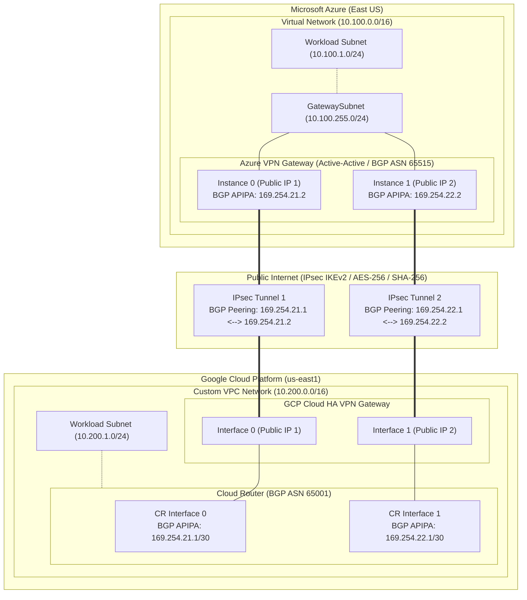

# Production-Grade Multi-Cloud VPN: Azure to GCP HA Interconnect

[](https://github.com/org/repo/actions/workflows/terraform-ci.yml)
[](https://www.terraform.io)
[](https://registry.terraform.io/providers/hashicorp/azurerm/latest)
[](https://registry.terraform.io/providers/hashicorp/google/latest)

Enterprise-grade, automated Terraform configuration to establish a resilient, **Active-Active High Availability (HA) IPsec VPN interconnect** with **dynamic BGP routing** between **Microsoft Azure** (Virtual Network Gateway) and **Google Cloud Platform** (Cloud HA VPN + Cloud Router).

---

## Architecture Overview

This architecture implements a dual-tunnel Active-Active VPN topology conforming to Microsoft Azure Well-Architected Framework and Google Cloud Architecture Center standards:



---

## Network & BGP Addressing Matrix

| Parameter | Azure | Google Cloud Platform |
| :--- | :--- | :--- |
| **VNet / VPC CIDR** | `10.100.0.0/16` | `10.200.0.0/16` (Global Routing) |
| **Workload Subnet** | `10.100.1.0/24` | `10.200.1.0/24` |
| **Gateway Subnet** | `10.100.255.0/24` | N/A (Managed by HA VPN Gateway) |
| **BGP ASN** | `65515` (Azure Standard) | `65001` (Private ASN) |
| **Tunnel 1 Gateway IP** | Azure Public IP 1 | GCP HA VPN Interface 0 IP |
| **Tunnel 1 BGP APIPA** | `169.254.21.2` | `169.254.21.1/30` |
| **Tunnel 2 Gateway IP** | Azure Public IP 2 | GCP HA VPN Interface 1 IP |
| **Tunnel 2 BGP APIPA** | `169.254.22.2` | `169.254.22.1/30` |

---

## Cryptographic & IPsec Security Standards

Both ends are configured with matching, high-assurance cryptographic parameters:

- **Protocol**: IKEv2
- **Phase 1 (IKE SA)**:
  - Encryption: `AES-256`
  - Integrity: `SHA-256`
  - Diffie-Hellman Group: `DHGroup14` (2048-bit MODP)
  - SA Lifetime: `28800s`
- **Phase 2 (Child SA)**:
  - Encryption: `AES-256`
  - Integrity: `SHA-256`
  - Perfect Forward Secrecy: `PFS2048` (PFS Group 14)
  - SA Lifetime: `27000s` / `102400000 KB`
- **Pre-Shared Keys**: High-entropy 32-character random strings generated dynamically using cryptographic pseudo-random generators (`random_password`).
- **Dead Peer Detection (DPD)**: Enabled (45 seconds timeout).

---

## Project Structure

```
.
├── .github/
│   └── workflows/
│       └── terraform-ci.yml        # CI pipeline for terraform fmt & validate
├── modules/
│   ├── azure_vnet/                 # Azure RG, VNet, Subnets, NSG & associations
│   │   ├── main.tf
│   │   ├── variables.tf
│   │   └── outputs.tf
│   ├── azure_vpn_gateway/          # Azure Active-Active VNG, Public IPs, LNGs & Connections
│   │   ├── main.tf
│   │   ├── variables.tf
│   │   └── outputs.tf
│   ├── gcp_vpc/                    # GCP Custom VPC, Subnetwork, Flow Logs & Firewall Rules
│   │   ├── main.tf
│   │   ├── variables.tf
│   │   └── outputs.tf
│   ├── gcp_ha_vpn/                 # GCP HA VPN Gateway, Cloud Router, External Gateway, Tunnels & BGP Peers
│   │   ├── main.tf
│   │   ├── variables.tf
│   │   └── outputs.tf
│   ├── shared_secrets/             # Dynamic cryptographic Pre-Shared Key generation
│   │   ├── main.tf
│   │   ├── variables.tf
│   │   └── outputs.tf
│   └── test_workloads/             # Optional lightweight Linux test VMs for verification
│       ├── main.tf
│       ├── variables.tf
│       └── outputs.tf
├── main.tf                         # Root module wiring Azure and GCP resources
├── variables.tf                    # Root input variables with validation & production defaults
├── outputs.tf                      # Root outputs & CLI verification commands
├── versions.tf                     # Provider constraints & backend definitions
├── terraform.tfvars.example        # Production variable values template
├── Makefile                        # Automation shortcuts (fmt, validate, plan, apply)
└── README.md                       # Architecture, operations, runbook & troubleshooting
```

---

## Prerequisites

1. **Terraform**: Version `>= 1.5.0` installed.
2. **Azure Account & CLI**:
   - Azure Subscription with `Network Contributor` and `Reader` permissions.
   - Authenticated via `az login` or Azure Service Principal environment variables:
     ```bash
     export ARM_CLIENT_ID="<client-id>"
     export ARM_CLIENT_SECRET="<client-secret>"
     export ARM_SUBSCRIPTION_ID="<subscription-id>"
     export ARM_TENANT_ID="<tenant-id>"
     ```
3. **Google Cloud Account & SDK**:
   - GCP Project with Compute Engine API enabled (`compute.googleapis.com`).
   - Authenticated via `gcloud auth application-default login` or GCP Service Account key:
     ```bash
     export GOOGLE_APPLICATION_CREDENTIALS="/path/to/service-account.json"
     ```

---

## Deployment Guide

### 1. Clone & Configure Variables

```bash
cp terraform.tfvars.example terraform.tfvars
```

Edit `terraform.tfvars` with your specific GCP Project ID and Azure details:

```hcl
gcp_project_id = "your-gcp-project-id"
azure_location = "eastus"
gcp_region     = "us-east1"
```

### 2. Initialize Terraform

```bash
make init
# or: terraform init
```

### 3. Review Plan

```bash
make plan
# or: terraform plan -var-file="terraform.tfvars"
```

### 4. Apply Infrastructure

> [!NOTE]
> Azure Virtual Network Gateway creation typically takes **25 to 45 minutes** to provision on Azure infrastructure.

```bash
make apply
# or: terraform apply -var-file="terraform.tfvars"
```

---

## Verification & Operational Runbook

Once `terraform apply` finishes, dynamic BGP routes converge within 60-90 seconds.

### 1. Verify Azure BGP Peering Status

Run the command from Terraform outputs:

```bash
az network vnet-gateway list-bgp-peer-status \
  --resource-group rg-hybrid-connectivity-prod \
  --name vgw-azure-hybrid-prod \
  -o table
```

**Expected Status**: `Connected` on both `169.254.21.1` and `169.254.22.1`.

### 2. Verify Learned Routes in Azure

```bash
az network vnet-gateway list-learned-routes \
  --resource-group rg-hybrid-connectivity-prod \
  --name vgw-azure-hybrid-prod \
  -o table
```

**Expected Output**: The GCP workload CIDR (`10.200.1.0/24`) is listed with `NextHop` pointing to the GCP BGP peering addresses.

### 3. Verify GCP HA VPN Tunnels

```bash
gcloud compute vpn-tunnels list \
  --project=your-gcp-project-id \
  --filter="region:(us-east1)"
```

**Expected Status**: Detailed status `Tunnel is up and running.`

### 4. Verify GCP Cloud Router BGP Session

```bash
gcloud compute routers get-status cr-gcp-hybrid-prod \
  --region=us-east1 \
  --project=your-gcp-project-id
```

**Expected Status**: `BgpPeerStatus` shows `ESTABLISHED` for both peers `cr-gcp-hybrid-prod-peer-0` and `cr-gcp-hybrid-prod-peer-1`.

---

## End-to-End Traffic Verification (Test VMs)

To provision lightweight test instances without exposing public IPs:

1. Set `enable_test_vms = true` in `terraform.tfvars`.
2. Apply changes: `terraform apply -var-file="terraform.tfvars"`.
3. Connect to GCP instance via Identity-Aware Proxy:
   ```bash
   gcloud compute ssh vm-gcp-test --zone=us-east1-b --tunnel-through-iap
   ```
4. Ping the Azure test VM's private IP (`10.100.1.4`):
   ```bash
   ping -c 5 10.100.1.4
   traceroute -n 10.100.1.4
   ```

---

## Failover & Resilience Testing

To test automated active-active failover:

1. Initiate continuous ping from GCP to Azure test VM:
   ```bash
   ping 10.100.1.4
   ```
2. In Azure Portal or CLI, reset / disable Connection 1:
   ```bash
   az network vpn-connection update \
     --resource-group rg-hybrid-connectivity-prod \
     --name vgw-azure-hybrid-prod-to-gcp-conn-1 \
     --set connectionMode=Responder
   ```
3. Observe ping output: BGP immediately fails over to Tunnel 2 with 0 to 1 packet drop.

---

## Troubleshooting Guide

| Issue | Potential Root Cause | Remediation |
| :--- | :--- | :--- |
| **BGP Status Stuck in `Connecting` or `Active`** | Mismatched APIPA IP addresses or missing `/30` on GCP interface. | Verify GCP router interface has `/30` mask (`169.254.21.1/30`) and Azure APIPA address is exact host (`169.254.21.2`). |
| **IKE Phase 1 / Phase 2 SA Fails** | Mismatched PSKs or encryption algorithms. | Ensure `ipsec_policy` parameters on Azure match GCP default IKEv2 profiles (AES256, SHA256, DHGroup14). |
| **Packet Loss on Large Packets (MTU)** | IPsec encapsulation overhead exceeds path MTU. | Clamp TCP MSS on workloads to `1350` bytes or set interface MTU to `1440` (Azure) / `1460` (GCP). |
| **Asymmetric Routing / High Latency** | Unequal MED or route priority between tunnels. | Ensure both GCP BGP peers have identical `advertised_route_priority` (default `100`). |
| **Traffic Dropped at Workload** | NSG or GCP Firewall rule blocking cross-cloud CIDR. | Ensure Azure NSG allows `10.200.0.0/16` and GCP Firewall allows `10.100.0.0/16`. |

---

## Security & Production Best Practices

- **Zero Hardcoded Secrets**: Pre-shared keys are generated via crypto-random provider and never committed to source control.
- **Dedicated Subnets**: `GatewaySubnet` has a dedicated `/24` space and no NSG attached (as mandated by Azure).
- **VPC Flow Logs**: Enabled on GCP subnets for continuous audit and network forensics.
- **Zone Redundancy**: Azure Public IPs and Gateway use `VpnGw2AZ` with Availability Zones `1, 2, 3` for data center level fault tolerance.
- **State File Encryption**: Store remote backend state in Azure Blob Storage with customer-managed keys (CMK) or Google Cloud Storage with KMS encryption.

