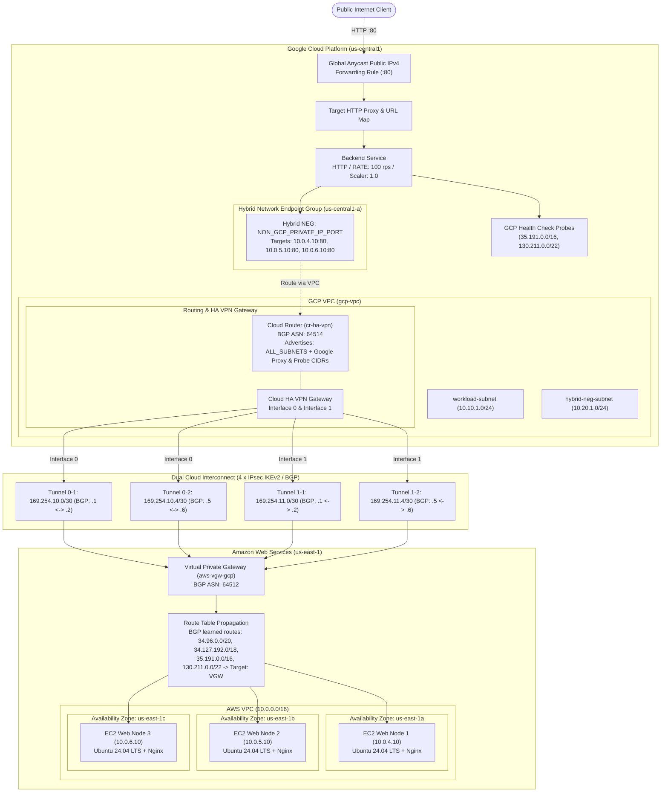

# Enterprise Multi-Cloud Ingress: GCP Global External ALB to AWS Private EC2 via Cloud HA VPN & Hybrid NEG

[](https://www.terraform.io)
[](https://registry.terraform.io/providers/hashicorp/aws/latest)
[](https://registry.terraform.io/providers/hashicorp/google/latest)
[](#high-availability--sla-architecture)
[-009688.svg)](#network-topology--bgp-addressing-matrix)
[](LICENSE)

An enterprise-grade, automated Terraform configuration establishing an end-to-end, multi-cloud traffic distribution architecture:
- **Edge Ingress**: Google Cloud Platform (GCP) **Global External Application Load Balancer** with Anycast IPv4 fronting global traffic.
- **Hybrid Core**: GCP **Hybrid Network Endpoint Group (NEG)** (`NON_GCP_PRIVATE_IP_PORT`) dispatching requests across clouds.
- **Resilient Transport**: GCP **Cloud HA VPN** coupled with AWS **Virtual Private Gateway (VGW)** via **4 active IPsec IKEv2 tunnels** and dynamic **BGP routing** (conforming to the 99.99% availability SLA).
- **AWS Backend**: Multi-AZ **Ubuntu 24.04 LTS Nginx** web nodes in isolated AWS private subnets with zero public exposure, managed via AWS Systems Manager (SSM).

---

## Table of Contents

- [Architectural Overview](#architectural-overview)
- [Visual Proof of Deployment](#visual-proof-of-deployment)
- [Traffic Flow & Packet Lifecycle](#traffic-flow--packet-lifecycle)
- [Network Topology & BGP Addressing Matrix](#network-topology--bgp-addressing-matrix)
- [High Availability & SLA Architecture](#high-availability--sla-architecture)
- [Security & Zero-Trust Posture](#security--zero-trust-posture)
- [Repository Structure](#repository-structure)
- [Prerequisites & IAM Permissions](#prerequisites--iam-permissions)
- [Deployment Guide](#deployment-guide)
- [Verification & Day-2 Operations](#verification--day-2-operations)
- [Troubleshooting Runbook](#troubleshooting-runbook)
- [Terraform Specifications](#terraform-specifications)
- [Decommissioning](#decommissioning)

---

## Architectural Overview

This solution enables organizations to utilize Google Cloud's Anycast Edge Network, Cloud Armor DDoS mitigation, and global points of presence (PoPs) to front and route HTTP traffic directly to compute infrastructure hosted inside private Amazon Web Services (AWS) subnets without exposing AWS workloads to the public internet.



---

## Visual Proof of Deployment

The following screenshots from live production Google Cloud and Amazon Web Services consoles validate the deployed infrastructure:

### 1. Successful Terraform Provisioning
Provisioning completed with 71 resources added across GCP and AWS, outputting instance IDs, static private IPs, and the GCP Load Balancer VIP (`136.82.69.238`):


---

### 2. Google Cloud Ingress & Hybrid NEG

#### GCP Global External Load Balancer
Frontend Anycast VIP `136.82.69.238:80` on the Premium Network Tier, forwarding to backend service `gcp-lb-lb-backend`:


#### Hybrid Network Endpoint Group (NEG)
Zonal NEG `hybrid-neg` (`NON_GCP_PRIVATE_IP_PORT`) in `us-central1-a` actively tracking the three AWS private IPs on port 80:


---

### 3. Google Cloud HA VPN & BGP Tunnels

#### Cloud HA VPN Tunnels (All 4 BGP Sessions Established)
All four IPsec tunnels operating concurrently with active BGP sessions:
- `ha-vpn-tunnel-0-1`: Interface 0 $\leftrightarrow$ `3.232.195.54` (BGP `169.254.10.2` / `169.254.10.1`) — **Established**
- `ha-vpn-tunnel-0-2`: Interface 0 $\leftrightarrow$ `35.171.253.131` (BGP `169.254.10.6` / `169.254.10.5`) — **Established**
- `ha-vpn-tunnel-1-1`: Interface 1 $\leftrightarrow$ `3.214.55.117` (BGP `169.254.11.2` / `169.254.11.1`) — **Established**
- `ha-vpn-tunnel-1-2`: Interface 1 $\leftrightarrow$ `107.21.203.197` (BGP `169.254.11.6` / `169.254.11.5`) — **Established**


#### Cloud HA VPN Gateway
Dual interfaces terminating on distinct Google border network routing engines (`34.183.40.104` and `34.184.40.117`):


#### Peer VPN Gateway (4 Public IPs)
GCP External Gateway configured with `FOUR_IPS_REDUNDANCY` matching AWS's 4 public endpoints:


---

### 4. Amazon Web Services (AWS) Infrastructure

#### Multi-AZ Private EC2 Instances
Three Ubuntu 24.04 web nodes running in private subnets across `us-east-1a`, `us-east-1b`, and `us-east-1c`. All status checks passing with strictly no public IPv4 addresses assigned:


#### AWS Virtual Private Gateway (VGW)
`aws-vgw-gcp` in `Available` state, attached to `aws-vpc` with Amazon ASN `64512`:


#### AWS Customer Gateways
Dual Customer Gateways mapping to GCP HA VPN interfaces with BGP ASN `64514`:


#### AWS Site-to-Site VPN Connections
Both VPN connections (`aws-to-gcp-conn-0`, `aws-to-gcp-conn-1`) in `Available` state:


---

## Traffic Flow & Packet Lifecycle

### 1. Ingress Journey (Client to AWS EC2)
1. **Anycast Ingress**: A user sends an HTTP request to the GCP Global Anycast IPv4 address (`136.82.69.238`). The packet is terminated at the closest Google Edge PoP.
2. **Envoy Proxy Processing**: The request is processed by Google's globally distributed Envoy proxy layer (`34.96.0.0/20`, `34.127.192.0/18`).
3. **Hybrid NEG Lookup**: The URL Map and Backend Service direct traffic to the zonal Hybrid NEG (`NON_GCP_PRIVATE_IP_PORT`). The NEG maintains static endpoints: `10.0.4.10:80`, `10.0.5.10:80`, and `10.0.6.10:80`.
4. **VPN Encapsulation**: Traffic addressed to AWS private subnets (`10.0.4.0/24`, `10.0.5.0/24`, `10.0.6.0/24`) is routed to `cr-ha-vpn`. Cloud Router selects one of the 4 active IPsec tunnels using BGP Equal-Cost Multi-Path (ECMP).
5. **Decapsulation at AWS**: The AWS Virtual Private Gateway (VGW) decapsulates the ESP packet and forwards the packet into the AWS VPC routing fabric.
6. **EC2 Delivery**: The packet arrives at the target EC2 instance. Security group `app-sg` validates the ingress source matches allowed Google Cloud proxy ranges and allows traffic on port 80.

### 2. Symmetrical Egress Return Journey (AWS EC2 back to Client)
> [!IMPORTANT]
> **Asymmetrical Routing Prevention**: In multi-cloud hybrid load balancing, backend instances in AWS receive packets with source IPs belonging to Google's Envoy proxies (`34.96.0.0/20`, `34.127.192.0/18`) or Health Checkers (`35.191.0.0/16`, `130.211.0.0/22`). Without specific routing, the AWS EC2 instance would send responses to `0.0.0.0/0` (the AWS NAT Gateway), causing connection drops.
- **Solution Implemented**: GCP Cloud Router advertises `var.gcp_lb_source_cidrs` over BGP.
- **Route Propagation**: AWS route propagation installs `/16`, `/18`, and `/20` prefixes into the AWS private route tables pointing to `aws-vgw-gcp`.
- **Longest Prefix Match (LPM)**: The EC2 instance routes responses through the VGW and back across the IPsec tunnel to Google's proxy, guaranteeing symmetrical bidirectional communication.

---

## Network Topology & BGP Addressing Matrix

### Cross-Cloud Network Parameters

| Parameter | Google Cloud Platform (GCP) | Amazon Web Services (AWS) |
| :--- | :--- | :--- |
| **Region / Zones** | `us-central1` (`us-central1-a`) | `us-east-1` (`us-east-1a`, `us-east-1b`, `us-east-1c`) |
| **VPC CIDR** | `10.10.0.0/16` / `10.20.0.0/16` | `10.0.0.0/16` |
| **Subnets** | `workload-subnet` (`10.10.1.0/24`)<br/>`hybrid-neg-subnet` (`10.20.1.0/24`) | Public: `10.0.1.0/24`, `10.0.2.0/24`, `10.0.3.0/24`<br/>Private: `10.0.4.0/24`, `10.0.5.0/24`, `10.0.6.0/24` |
| **BGP ASN** | `64514` (Cloud Router) | `64512` (Virtual Private Gateway) |
| **Workload Endpoints** | Hybrid NEG (`NON_GCP_PRIVATE_IP_PORT`) | EC2 Nodes: `10.0.4.10`, `10.0.5.10`, `10.0.6.10` |

### 4-Tunnel HA VPN Interconnect Matrix

Inside IP CIDRs are non-overlapping `/30` subnets allocated within `169.254.0.0/16`, deliberately avoiding AWS-reserved ranges (`169.254.0.0/30`–`169.254.5.0/30`, `169.254.169.252/30`):

| Tunnel ID | AWS VPN Conn | AWS Tunnel | GCP Interface | Peer Interface | Inside CIDR | AWS VGW IP | GCP Router IP | Pre-Shared Key |
| :--- | :--- | :--- | :--- | :--- | :--- | :--- | :--- | :--- |
| **`0-1`** | `vpn_conn_0` | Tunnel 1 | Interface 0 | Interface 0 | `169.254.10.0/30` | `169.254.10.1` | `169.254.10.2` | `vpn_<random_32_chars>` |
| **`0-2`** | `vpn_conn_0` | Tunnel 2 | Interface 0 | Interface 1 | `169.254.10.4/30` | `169.254.10.5` | `169.254.10.6` | `vpn_<random_32_chars>` |
| **`1-1`** | `vpn_conn_1` | Tunnel 1 | Interface 1 | Interface 2 | `169.254.11.0/30` | `169.254.11.1` | `169.254.11.2` | `vpn_<random_32_chars>` |
| **`1-2`** | `vpn_conn_1` | Tunnel 2 | Interface 1 | Interface 3 | `169.254.11.4/30` | `169.254.11.5` | `169.254.11.6` | `vpn_<random_32_chars>` |

> [!NOTE]
> **AWS PSK Format Constraint**: AWS Site-to-Site VPN enforces that tunnel pre-shared keys must be 8–64 characters and **cannot start with the character `0` (zero)**. The Terraform configuration utilizes a deterministic prefix format `vpn_${random_password.psk[k].result}` to ensure strict compliance.

---

## High Availability & SLA Architecture

Google Cloud HA VPN provides a **99.99% service availability SLA** when configured with 4 tunnels terminating on redundant peer gateway endpoints:

```
                  +-----------------------------+
                  |    GCP HA VPN Gateway       |
                  | [If 0: IP_A]  [If 1: IP_B]  |
                  +-------+-------------+-------+
                          |             |
           +--------------+--+       +--+--------------+
           |                 |       |                 |
      [Tunnel 0-1]      [Tunnel 0-2] [Tunnel 1-1]      [Tunnel 1-2]
           |                 |       |                 |
           +--------------+--+       +--+--------------+
                          |             |
                  +-------+-------------+-------+
                  |     AWS External CGWs       |
                  | [CGW 0: IP_A] [CGW 1: IP_B] |
                  +--------------+--------------+
                                 |
                  +--------------+--------------+
                  |  AWS Virtual Private Gateway|
                  |      (Amazon ASN 64512)     |
                  +-----------------------------+
```

1. **Dual GCP Interfaces**: Terminating on two distinct GCP border network routing engines.
2. **Dual AWS VPN Connections**: Bound to separate Customer Gateways with sequential locking (`depends_on = [aws_vpn_connection.vpn_conn_0]`) preventing AWS `ConcurrentMutationLimitExceeded` API exceptions.
3. **Autonomous Dynamic Failover**: BGP sessions exchange keepalives every 30 seconds (hold timer 90 seconds). If any tunnel or gateway degrades, routes automatically withdraw and converge over the surviving tunnels within seconds.

---

## Security & Zero-Trust Posture

- **Zero Public EC2 Exposure**: Backend EC2 instances reside strictly in private subnets (`10.0.4.0/24`–`10.0.6.0/24`) with `associate_public_ip_address = false`. No Internet Gateway routing exists for private subnets.
- **Zero SSH / Bastionless Access**: Port 22 is disabled across all security groups. Administration is mediated through **AWS Systems Manager (SSM) Session Manager** via IAM instance profile attaching `AmazonSSMManagedInstanceCore`.
- **IMDSv2 Enforcement**: EC2 metadata options enforce `http_tokens = "required"` and `http_put_response_hop_limit = 1`, neutralizing Server-Side Request Forgery (SSRF) attack vectors.
- **Strict Ingress Filtering**:
  ```hcl
  ingress_rules = [{
    description = "HTTP from Google LB / health check ranges arriving over the VPN"
    from_port   = 80
    to_port     = 80
    protocol    = "tcp"
    cidr_blocks = [
      "34.96.0.0/20",    # Envoy Global External Application LB proxies
      "34.127.192.0/18", # Envoy Global External Application LB proxies
      "35.191.0.0/16",   # Google Cloud Health Check probes
      "130.211.0.0/22"   # Google Cloud Health Check probes
    ]
  }]
  ```
- **IPsec Cryptography**: IKEv2 with cryptographic dynamic keys generated by Terraform's CSPRNG `random_password` provider.

---

## Repository Structure

```
.
├── Makefile                                # Lifecycle automation targets (init, plan, apply, test)
├── README.md                               # Production architecture and operations manual
├── screenshots/                            # Live deployment validation screenshots
│   ├── 01-terraform-apply-outputs.png
│   ├── 02-aws-ec2-instances-multi-az.png
│   ├── 03-aws-customer-gateways.png
│   ├── 04-aws-virtual-private-gateway.png
│   ├── 05-aws-vpn-connections.png
│   ├── 06-gcp-ha-vpn-tunnels-bgp-established.png
│   ├── 07-gcp-ha-vpn-gateway-dual-interfaces.png
│   ├── 08-gcp-peer-vpn-gateway-four-ips.png
│   ├── 09-gcp-external-load-balancer-details.png
│   └── 10-gcp-hybrid-neg-endpoints.png
└── terraform/
    ├── main.tf                             # Primary multi-cloud orchestration (VPN, Compute, NEG, LB)
    ├── variables.tf                        # Variable schema and enterprise defaults
    ├── outputs.tf                          # Infrastructure endpoints, resource IDs, test commands
    ├── versions.tf                         # Provider version locks (AWS ~> 6.0, GCP ~> 8.0)
    ├── terraform.tfvars.example            # Sample configuration values
    └── modules/
        ├── aws/
        │   ├── security-groups/            # Reusable AWS security group module
        │   ├── vpc/                        # Modular AWS VPC with IGW & NAT Gateways
        │   ├── launch_template/            # Launch template module
        │   └── auto_scaling_group/         # ASG module
        └── gcp/
            ├── lb/                         # GCP Global HTTP(S) External Application LB module
            ├── network_endpoint_groups/
            │   └── hybrid_neg/             # GCP NON_GCP_PRIVATE_IP_PORT Hybrid NEG module
            └── vpc/                        # GCP VPC, custom subnets, and firewall rules
```

---

## Prerequisites & IAM Permissions

### 1. Local Tooling
- **Terraform**: `v1.5.0` or higher
- **AWS CLI**: `v2.x` configured with `aws configure`
- **Google Cloud SDK**: `gcloud` authenticated via `gcloud auth application-default login`
- **cURL / jq**: For automated endpoint testing

### 2. Required Cloud Permissions
- **AWS IAM**: EC2 full access (`ec2:*`), IAM instance profile creation (`iam:*`), SSM access.
- **GCP IAM**: `roles/compute.networkAdmin`, `roles/compute.loadBalancerAdmin`, `roles/compute.securityAdmin`.

### 3. GCP API Activation
Ensure the Compute Engine API is enabled in your Google Cloud Project:
```bash
gcloud services enable compute.googleapis.com --project <YOUR_GCP_PROJECT_ID>
```

---

## Deployment Guide

### Step 1: Clone and Configure
Navigate to the `terraform/` directory and configure your variables:
```bash
cd terraform/
cp terraform.tfvars.example terraform.tfvars
```

Edit `terraform.tfvars`:
```hcl
aws_region      = "us-east-1"
public_subnets  = ["10.0.1.0/24", "10.0.2.0/24", "10.0.3.0/24"]
private_subnets = ["10.0.4.0/24", "10.0.5.0/24", "10.0.6.0/24"]
azs             = ["us-east-1a", "us-east-1b", "us-east-1c"]
instance_type   = "t3.small"

gcp_project_id  = "encoded-alpha-457108-e8"
gcp_region      = "us-central1"
gcp_zone        = "us-central1-a"
environment     = "prod"
```

### Step 2: Initialize & Validate
```bash
# Using Makefile from root
make init
make validate

# Or directly with Terraform
cd terraform/
terraform init
terraform validate
```

### Step 3: Plan Infrastructure
Generate and review the execution plan:
```bash
terraform plan -var-file="terraform.tfvars"
```

### Step 4: Apply & Provision
```bash
terraform apply -var-file="terraform.tfvars"
```
*Provisioning takes approximately 4–6 minutes while AWS creates the Virtual Private Gateway, NAT Gateway, EC2 instances, and GCP provisions the HA VPN Gateway and Global Load Balancer.*

Upon completion, Terraform outputs all connection details:


---

## Verification & Day-2 Operations

### 1. Verify BGP Peering State (GCP Cloud Router)
Run the automated command outputted by Terraform:
```bash
$(terraform output -raw bgp_status_command)
```
**Expected Output**:
All four BGP peers (`bgp-peer-0-1`, `bgp-peer-0-2`, `bgp-peer-1-1`, `bgp-peer-1-2`) must display:
```yaml
bgpPeerStatus:
  - name: bgp-peer-0-1
    status: ESTABLISHED
    numLearnedRoutes: 4
  - name: bgp-peer-0-2
    status: ESTABLISHED
  - name: bgp-peer-1-1
    status: ESTABLISHED
  - name: bgp-peer-1-2
    status: ESTABLISHED
```

### 2. Verify GCP Backend Service Health
Query the health check state of the Hybrid NEG endpoints:
```bash
gcloud compute backend-services get-health gcp-lb-lb-backend \
  --global \
  --project $(terraform output -raw gcp_project_id 2>/dev/null || echo "encoded-alpha-457108-e8")
```
**Expected Output**:
```yaml
backend: projects/.../zones/us-central1-a/networkEndpointGroups/hybrid-neg
status:
  healthStatus:
  - healthState: HEALTHY
    instance: 10.0.4.10:80
  - healthState: HEALTHY
    instance: 10.0.5.10:80
  - healthState: HEALTHY
    instance: 10.0.6.10:80
```

### 3. Live Traffic Validation
Send requests to the GCP Global Anycast IP:
```bash
LB_IP=$(terraform output -raw gcp_lb_ip_address)
echo "Testing Global Load Balancer VIP: http://${LB_IP}"

for i in {1..5}; do
  curl -s "http://${LB_IP}" | grep -E "(Instance ID|Availability Zone|Private IP)"
  sleep 1
done
```
**Sample Output demonstrating multi-AZ load distribution across AWS**:
```html
<p><b>Instance ID:</b> i-03a89bc4412f91a01</p>
<p><b>Availability Zone:</b> us-east-1a</p>
<p><b>Private IP:</b> 10.0.4.10</p>
---
<p><b>Instance ID:</b> i-0a811cb239e120d22</p>
<p><b>Availability Zone:</b> us-east-1b</p>
<p><b>Private IP:</b> 10.0.5.10</p>
```

---

## Troubleshooting Runbook

| Symptom | Probable Root Cause | Diagnostic & Remediation Steps |
| :--- | :--- | :--- |
| **BGP Status `CONNECT` or `IDLE`** | IPsec IKEv2 SA negotiation failure or link-local IP mismatch | 1. Check IPsec tunnel state: `aws ec2 describe-vpn-connections --vpn-connection-ids <CONN_ID>`<br/>2. Verify pre-shared key format (must not start with `0`).<br/>3. Ensure inside CIDRs avoid reserved ranges (`169.254.0.0/30`-`169.254.5.0/30`). |
| **Backend `UNHEALTHY` in GCP** | Route propagation missing or security group dropping probes | 1. Check AWS route table: Ensure `35.191.0.0/16` and `130.211.0.0/22` route to target `vgw-*`.<br/>2. Inspect `module.app_sg`: Confirm port 80 is open to `var.gcp_lb_source_cidrs`.<br/>3. SSH via SSM to instance: `curl -I http://localhost:80` to confirm Nginx is healthy. |
| **`ConcurrentMutationLimitExceeded`** | AWS rate limiting simultaneous attachments to a single VGW | Ensure `aws_vpn_connection.vpn_conn_1` contains `depends_on = [aws_vpn_connection.vpn_conn_0]`. |
| **`Subnetwork cannot be specified`** | Subnetwork set on `NON_GCP_PRIVATE_IP_PORT` NEG | Hybrid NEGs do not reside in a GCP subnet. Ensure `subnetwork` is omitted in `google_compute_network_endpoint_group`. |
| **`None of the backends have a valid capacity`** | Backend capacity scaler set to 0 or metric conflicts | Ensure `capacity_scaler = 1.0` and `balancing_mode = "RATE"` with `max_rate_per_endpoint = 100`. |

---

## Terraform Specifications

### Inputs

| Name | Description | Type | Default | Required |
| :--- | :--- | :--- | :--- | :---: |
| `aws_region` | AWS deployment region | `string` | `"us-east-1"` | no |
| `gcp_project_id` | Target Google Cloud Project ID | `string` | n/a | **yes** |
| `gcp_region` | GCP deployment region for HA VPN & Cloud Router | `string` | `"us-central1"` | no |
| `gcp_zone` | GCP deployment zone for Hybrid NEG | `string` | `"us-central1-a"` | no |
| `environment` | Deployment stage environment name | `string` | `"dev"` | no |
| `public_subnets` | CIDR ranges for AWS public subnets | `list(string)` | `["10.0.1.0/24", ...]` | no |
| `private_subnets` | CIDR ranges for AWS private subnets housing EC2 nodes | `list(string)` | `["10.0.4.0/24", ...]` | no |
| `azs` | AWS Availability Zones corresponding to subnets | `list(string)` | `["us-east-1a", ...]` | no |
| `instance_type` | EC2 instance sizing for backend nodes | `string` | `"t3.micro"` | no |
| `gcp_lb_source_cidrs` | Google Cloud Envoy proxy and health check ranges | `list(string)` | `["34.96.0.0/20", ...]` | no |
| `tags` | Map of operational metadata tags for AWS resources | `map(string)` | `{ ManagedBy = "terraform" }` | no |

### Outputs

| Name | Description | Sensitive |
| :--- | :--- | :---: |
| `gcp_lb_ip_address` | Global external Anycast IPv4 address for ingress | no |
| `gcp_hybrid_neg_id` | Fully qualified Google Cloud Resource ID of the Hybrid NEG | no |
| `gcp_hybrid_neg_name` | Name of the provisioned Hybrid NEG | no |
| `registered_hybrid_endpoints` | List of target AWS EC2 private IP/Port endpoints registered | no |
| `aws_instance_ids` | List of instance IDs for the backend AWS EC2 nodes | no |
| `aws_instance_private_ips` | Private IP addresses assigned to the AWS EC2 nodes | no |
| `bgp_status_command` | Direct CLI command to verify multi-tunnel BGP session states | no |

---

## Decommissioning

To destroy all cloud infrastructure in an orderly, dependency-aware manner:

```bash
terraform destroy -var-file="terraform.tfvars"
```

> [!CAUTION]
> Destroying this configuration will terminate the IPsec tunnels, release the GCP Global Anycast IP address, and terminate all backend EC2 instances. Ensure DNS traffic has been redirected prior to teardown.
